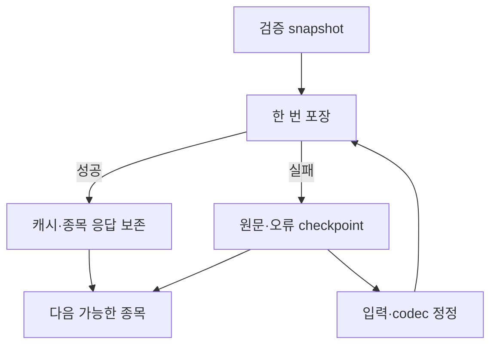

# MON 중복 제거·NAS 정상화·처리 시간 개선 설계

2026-10-12 KST · **MON-ERRC-D2.0** · 구현 대상 **mon.php 1.8.5(예정)** · 기준 코드 **1.8.4 / 지시문 v4.12**

이번 산출물은 코드 수정을 위한 설계다. 구현·NAS 적용·운영 정상화 완료를 뜻하지 않는다. 기존 ERR-C의 **제거(Eliminate)·축소(Reduce)·강화(Raise)·추가(Create)**를 적용한다. 현재 실행 계약은 [monitor.md](monitor.md)의 `MON:INSTRUCTION` 블록이고, 기존 완료 검증은 [mon_completion_enforcement.md](mon_completion_enforcement.md)다. 이 문서는 아래 변경의 단일 설계 원본이며 과거 설계의 종료 상한을 되살리지 않는다.

기준 커밋 `05e67c7182474ae78e86d01a34acf9e170ac3240`, `mon.php` blob `503d1111846570e3eb4681487699dbc203375715`. 구현 시 최신 head와 실제 설정을 다시 확인한다. 현재 코드에 존재하지 않는 아래 새 필드·상태는 모두 **구현 예정**이다.

## 1. 실제 문제와 수정 범위

| 문제 | 확인 근거 | 영향·우선순위 | 설계 |
|---|---|---|---|
| 동일 원시 일봉의 3중 포함 | `MonDetails::cached`의 `origin.raw_records`, `origin.history_metadata.raw_records`, snapshot의 `history_metadata.raw_records`. 현재 pack은 첫 경로만 중복 제거 | `DETAIL_PAYLOAD_TOO_LARGE`, 정상 입력도 수집 중단. **P0/blocker** | D01 |
| 보호 범위 밖 재포장 | `MonDetailWorker::processOne`이 캐시용 pack 후 응답에서 다시 pack; 재사용 경로도 응답 pack 예외가 보호 범위 밖 | 한 종목 오류가 후속 종목과 회차 진행을 막음. **P0/blocker** | D02 |
| 아카이브가 최초 1회만 분리됨 | `MonGaps::stage`는 기존 archive manifest가 있으면 새 strategy_archive 증가를 분리하지 않음 | 공유 파일 여유 소진·요청 등록 거절. **P1/material** | D03 |
| 게시가 실행을 먼저 닫음 | `MonPublication::process`의 finally에서 finish, 닫힌 실행에 `MonExecution::report` 거절 | 외부 계측 누락·늦은 통계 보충·완료 책임 중복. **P1/material** | D06 |
| NAS 건강과 분석 완료 범위 혼동 | 관측 NAS 1.8.4는 heartbeat 정상이나 readiness=error, pending 5건; 분석·저장 완료 영수증은 유효 | NAS 정상화 미완료가 완료 표현에서 사라짐. **P1/material** | D07 |
| 긴 준비·반복 확인·대량 문서 왕복 | 실제 실행의 문맥 등록 562.214145초, 서버 분석·게시 종료 3388.258712초 | 사용자 대기·불필요한 반복. 단계별 원인 비율은 미측정 | D04–D06, D08 |

고정 수식 MON-P3.1, MACD(12,26,9), ChatGPT의 자율 선정, 국가별 당일 신규 20개 목표, 현재가·거래 확인 300초, 원문 증명·파일 소유권·NAS 수동 시작을 유지한다. 주문·cron·NAS 자동 재시작을 추가하지 않는다. 정상 기능의 전면 재작성과 전체 과거 PASS 재시험은 범위 밖이다.

### 관측된 중복 제거 효과

직전 읽기 전용 재현에서 동일 원문을 한 번 보관하고 제거 위치를 복원했을 때의 결과다. 새 코드의 시험 성적이나 NAS 적용 성적이 아니다. 수치·원문·출처·시각을 포함한 복원 snapshot의 canonical JSON은 원본과 동일했다.

| 종목 ID | 현재 pack의 Base64 길이 | 단일 원문 보관 길이 | 원본 복원 일치 |
|---|---:|---:|---|
| JP\|TSE\|6098 | 27,248 | 16,272 | 확인 |
| KR\|KOSPI\|006400 | 27,472 | 16,964 | 확인 |
| KR\|KOSPI\|051910 | 27,016 | 16,656 | 확인 |
| KR\|KOSPI\|096770 | 27,772 | 16,960 | 확인 |
| US\|NYSE\|WMT | 29,600 | 17,840 | 확인 |

한도는 **Base64 문자열 20,480바이트**다. gzip 바이너리 20KiB로 해석하지 않는다. 압축 해제 및 복원 snapshot은 각각 262,144바이트 이내여야 한다. 새 marker 비용을 포함한 최종 구현 payload로 다시 검증한다. 원문 절단·봉 개수 축소·가격 반올림·한도 증가는 해결책으로 쓰지 않는다.

## 2. ERR-C 변경표

| 기준 | 변경 | 코드·지시문의 책임 | 통과 증거 |
|---|---|---|---|
| **제거 E** | 동일 원문 복제, 캐시/응답 이중 pack, publisher/orchestrator 이중 종료, 성공 플래그에 의한 정상화 표현 제거 | D01·D02·D06·D07 | 정확한 복원 SHA, 종목당 pack 1회, finish 소유자 1개, 오류 NAS의 overall_complete=false |
| **축소 R** | 동일 입력 계산·지수 조회·전체 문서 읽기·전체 재준비·중복 ref 갱신 축소 | D03–D05·D08 | 캐시 키/무효화 사유, 실제 HTTP와 cache hit 분리, 변경 국가만 재계산, 응답 유실 시 GET 우선 |
| **강화 R** | 종목 오류 격리, 기존 정상본 보존, 저장 여유 사전 검사, 해시·현재성·동시 변경 검증 강화 | D01–D05·D07 | 오류 뒤 다음 종목 진행, 훼손 입력 거절, 예약 여유, collection 보존, 오래된 시세 거절 |
| **추가 C** | 직렬화 복구 작업, 반복 가능한 아카이브 분리, 완료 범위별 영수증, 종료 전 계측 확인 추가 | D02·D03·D06·D07 | 같은 실행 ID의 재개, 참조 파일 실제 저장, 필수 범위 0건, 외부 작업 ACK 후 finish |

## 3. 중복 없는 책임 배분

기존 클래스를 수정한다. 별도 계산기·게시 엔진·종료 판정기를 만들지 않는다.

| 작업 | 단일 책임자 | 입력·재사용 기준 | 다른 계층의 역할 |
|---|---|---|---|
| 원천 수집·부분 checkpoint | `MonDaily` | request/target/source와 원문 해시 | Worker는 결과와 실패를 이어 전달 |
| 수치·snapshot | `MonSwing` / `MonDetails::snapshot` | 봉·지수·가격 기준·수식 버전 | ChatGPT는 수치를 재계산하지 않고 선정 |
| 손실 없는 포장·복원 | `MonDetails::pack/unpack` | snapshot canonical SHA·codec 버전 | Worker/캐시/응답은 같은 packed 결과 사용 |
| 종목 상태·오류·공정 스케줄 | `MonDetailWorker` / 기존 schedule | 논리 요청 ID, 단계와 다음 허용시각 | 진행 조회는 저장 상태만 읽음 |
| 저장 공간·원문/이력 분리 | `MonRun::storage` / `MonGaps` | 실제 바이트·예약값·archive SHA | 등록·prepare·finalize가 같은 정책 사용 |
| 파일 쌍·참조 의존성 저장 | `MonArtifact` / `MonPublication` | 검증 artifact, 보호 journal, 실제 head | 커넥터는 지정된 한 전송 경로 |
| 필수 범위 검증 | `MonCompletion` | 보호 scope·게시 증명·NAS 관측 | UI/통계/지시문은 판정을 인용 |
| 실행 종료·통계 | `MonExecution` | 완료 검증과 계측 ACK | publisher는 게시 단계만 마감 |

## 4. D01 — 원문 1회 보관과 정확한 복원

1. 유효 snapshot의 세 알려진 경로만 비교한다. 기준은 `history_metadata.raw_records`이며 `MonRun::json`의 **정확한 값 일치**로 판단한다. 다른 원문·다른 날짜·누락 필드·타입 차이를 동일 자료로 합치지 않는다.
2. canonical 원문은 기준 경로에 남긴다. 같은 값인 `origin.raw_records`, `origin.history_metadata.raw_records`만 작업 복사본에서 제거한다. 원본 객체·출처·검증시각·지표를 변경하지 않는다. 다른 값은 그대로 유지한다.
3. 기존 `transport_raw_records_deduplicated` marker를 버전 있는 객체로 확장한다. 제안 필드: `version=2`, 고정 `source_path`, 실제 제거한 `restore_paths`, `raw_records_sha256`, 제거 전 전체 `snapshot_sha256`. 복원 경로는 위 두 경로의 화이트리스트만 허용한다. 일반 JSON 경로 실행이나 임의 객체 덮어쓰기를 허용하지 않는다.
4. unpack은 packed 본문의 길이/SHA를 먼저 확인하고, marker·원문 SHA·빈 복원 위치를 검증한다. 허용 위치를 복원한 뒤 marker를 제거하고 전체 snapshot SHA와 복원 크기를 확인한다. 필요 부모 객체가 없거나 복원 위치에 다른 값이 있으면 명시 오류다.
5. **구형 reader는 객체 marker를 거절한다.** 기존 marker=true와 marker 없는 payload는 새 reader가 그대로 읽는다. capability/reader 버전 확인 전에는 새 writer를 활성화하지 않는다. NAS·로컬 고정 PHP가 새 reader를 갖춘 뒤 writer를 전환한다. 포장 방식은 gzip+base64, 수치 계약은 유지한다.
6. 최종 pack이 20,480바이트를 넘으면 D02로 넘긴다. 중복 제거로도 해결되지 않는 원문은 무손실 참조 입력 복구가 필요하며, native reader가 그 참조를 실제 검증하기 전 usable/latest/정상으로 바꾸지 않는다.

**수정 위치:** `MonDetails::pack`, `unpack`, `cached`의 metadata 생성, `checkedSnapshot` 경로. 지시문에 codec 알고리즘을 복제하지 않고 이 절만 연결한다.

## 5. D02 — 종목 오류 격리와 단계별 복구

`processOne`의 재사용·수집·계산·pack·캐시 보관·응답 생성 전체를 종목 단위 보호 경계 안으로 옮긴다. 검증 snapshot당 pack은 한 번이며 `$packed`를 캐시와 응답에서 공유한다. 성공 캐시는 새 값의 포장과 저장이 확인된 후에만 교체한다.

| 실패 분류 | 보존·다음 처리 | 다시 하지 않을 작업 |
|---|---|---|
| `DETAIL_PAYLOAD_TOO_LARGE` / 복원 실패 | 이전 정상 cache와 원문 checkpoint 보존; `serialization_pending`과 복구 원인/입력 SHA 기록 | 같은 원문을 크기 오류 때문에 재조회 |
| 지수만 누락 | 저장된 종목 원문에서 benchmark 단계 재개 | 종목 일봉 재수집 |
| 429·일시 네트워크 오류 | 기존 retry_wait/Retry-After와 증가 대기, 같은 요청 재개 | 대기 중 실제 HTTP 재전송 |
| 401/403·권한/설정 오류 | blocked, 실제 정정 후 resume | 인증 실패의 빠른 무한 반복 |
| 가격 기준·원문 해시 충돌 | conflict와 원문 보존, 추가 출처 검증 | 성공/WAIT로 덮어쓰기 |
| 디스크·보호 journal 저장 실패 | 상위 운영 오류와 미보존 checkpoint 명시 | 저장되지 않은 진행의 완료 표시 |

`serialization_pending`은 구현 예정인 비종결 상태다. `MonDetails::matching/retryPending/mergedResponses`, 요청 슬롯 정리, `MonData`의 응답 검증, `MonProgress`의 상태 집계·웹 표시, daemon의 detailWorkDue, scheduler, 완료 큐를 함께 보강한다. 해당 종목은 동일 실패 입력/동일 codec이면 네트워크 없이 대기하고 **다음 가능한 종목을 공정하게 진행**한다. 재시도 조건은 codec/입력/복구 참조의 실제 변화 또는 명시 정정이다. 종목 요청은 지우지 않는다. 수집 attempts와 serialize attempts는 분리하며 실제 외부 호출만 수집 시도로 센다.

이전 정상 snapshot이 있으면 참고 사용 가능 여부와 현재 요청 충족 여부를 별도 표시한다. 새 payload가 없는데 usable/latest로 표시하지 않는다. 예외가 발생한 뒤에도 응답은 작은 오류 메타데이터로 생성한다. 사용자 중단·프로세스 자원 보호·저장 장치 장애는 무조건 삼키지 않고 기존 운영 경계로 전달한다.

## 6. D03 — 반복 가능한 저장 공간 확보

주 파일 최대 **2,097,152바이트**와 NAS **96MiB**를 유지한다. 1.8.4 `MonRun::storage`는 실제 설정의 collection 예약값을 사용하므로 고정 문서 숫자로 대체하지 않는다. 직전 실행은 등록 실패 후 예약을 655,360→524,288바이트로 낮춘 상태이고, 최종 owned 1,570,224바이트에 예약 524,288바이트를 더하면 여유는 **2,640바이트**였다. 이는 개선 완료가 아니다.

- 등록/prepare/finalize 전에 같은 `MonRun::storage`를 사용한다. 최소한 `actual_bytes <= max_bytes` 및 `owned_bytes + collection_reserve_bytes <= max_bytes`를 동시에 통과해야 한다. 최대 활성 상세 30개와 시세·오류 응답의 실제 직렬화 크기로 예약 필요량도 확인한다. root/collection 한도를 높이거나 예약을 계속 줄이지 않는다. 분리 후 655,360바이트를 복원할 수 있는 여유를 검증하며, 부족하면 공간 작업을 계속한다.
- `MonGaps::stage`의 최초 archive manifest 유무 조건을 **새 고유 이력의 실제 증가/공간 필요 조건**으로 바꾼다. 새 strategy/source 항목을 canonical SHA로 중복 판정하고 이미 보관한 같은 항목을 다시 append하지 않는다. 서로 다른 출처·시각·판단은 내용이 비슷해도 유지한다.
- 기존 `mon_recovery_inputs.json`, `mon_recovery_archive.json`과 그 SHA는 유지한다. 새 고유 이력은 루트의 불변 `mon_recovery_archive_<sha256>.json` 등으로 분리한다. 파일마다 2MiB 이하이며 입력을 순차 처리해 메모리 내 전체 이력을 펼치지 않는다.
- 주 파일에는 검증된 최신 manifest 참조와 활성 자료만 둔다. manifest는 현재 segment와 이전 manifest의 path/blob SHA/SHA256를 연결한다. lookup은 필요한 항목을 한 segment씩 읽고 다음 cursor를 보호 저장한다. 긴 이력은 회차를 이어 읽으며 재귀 전체 로딩·시간 초과를 자료 없음으로 변환하지 않는다. 순환 참조·다른 저장소/임의 URL·해시 불일치를 거절한다.
- `MonArtifact`의 보호 metadata에 archive 의존성과 SHA를 포함한다. `MonPublication`은 의존 blob을 먼저 준비하고 **새 archive/manifest와 결과 파일 쌍을 같은 tree/원자 ref**로 게시한다. 외부 저장 증명 전 inline 고유 자료를 제거하지 않는다. 실패하면 이전 파일 쌍·원문 checkpoint·같은 job을 유지한다. 구형 reader가 새 manifest를 못 읽는 동안 writer 전환을 보류한다.
- collection-only head 변경은 기존 native 병합으로 보존한다. 분석/설정 변경은 충돌이며 덮어쓰지 않는다. 기존 archive를 정리·삭제하는 작업은 이번 변경에 포함하지 않는다.

## 7. D04 — 변경 입력만 계산하고 공통 원천 재사용

숫자 캐시 키는 `(symbol_id, target_completed_date, normalized_bars_sha256, benchmark_id/benchmark_bars_sha256, price_basis, criteria_version, 계산 코드 버전)`이다. 원문/출처 증명 캐시는 별도 원문 SHA와 검증 버전을 포함한다. 계획/snapshot 캐시는 신원·통화·거래소와 tick_rule/유효일·근거 SHA도 확인한다. 이 값이 달라지면 숫자가 같아도 가격 계획과 snapshot을 재검증한다. 실행 ID·표시시각만 달라졌다고 수치를 재계산하지 않으며, 출처 checked_at을 새 시각으로 바꾸지도 않는다. 봉/지수/분할·수식/검증 방식이 바뀌면 해당 결과를 무효화한다.

공통 지수는 동일 benchmark/대상 완료일/가격 기준/같은 검증 거래일 구간별로 한 번 수집·검증해 재사용한다. 현재의 유효한 메모/부분 checkpoint를 확장하고 별도 네트워크 우회 수집기를 추가하지 않는다. 장중 시세·거래 상태·기업 최신 위험 확인은 수치 캐시와 분리해 현재성을 검사한다. 현지 날짜가 같다는 이유만으로 새로운 공시·정지 확인을 생략하지 않는다.

prepare는 원문·범위·기업 근거를 먼저 확보한 뒤 한 번 수행한다. collection의 무관한 변화나 같은 snapshot을 반복 읽었다는 이유로 전체 prepare를 반복하지 않는다. 늦은 신규 완료봉·중대한 사건·선정 입력 변경은 native pending_analysis/reprepare로 처리하며, 변경 국가의 수치를 갱신한 후 **전체 적격 후보의 동등 비교**를 다시 수행한다. 신규 발견 20개와 상세 30개 슬롯을 혼동하지 않고 기존 quota_date/first_seen_at을 유지한다.

기업 검토는 현재 계약의 bounded review(최신 재무·이후 중요 사건·알려진 미해결 항목)에 맞춘다. 충분한 실제 근거 없이 조사 완료로 처리하거나 모든 과거 문서 재수집으로 범위를 늘리지 않는다. 최신 달력의 session/open/close를 사용하며 검증된 장외를 정상 대기로 인정한다.

## 8. D05 — 불필요한 검증·저장 왕복 제거

환경마다 **한 실제 게시 전송 경로**를 선택한다. NAS 운영자 API 사용 가능이면 native 게시, 그렇지 않으면 허용된 커넥터 게시 후 native 원격 읽기 검증을 사용한다. 두 경로가 같은 artifact를 별도로 쓰지 않는다. 커넥터 응답은 실제 요청·remote SHA를 전달하는 어댑터이며 가짜 HTTP200/저장 영수증을 만들지 않는다.

`MonPublication::source/receipt`는 확인한 파일 쌍과 immutable SHA의 검증 결과를 재사용하되 현재 head/선정 현재성은 기존 규격대로 다시 확인한다. ref 응답이 유실됐으면 GET부터 한다. 동일 filepair가 실제 저장돼 있으면 새 commit/ref를 만들지 않는다. collection만 달라졌으면 해당 collection을 보존하고, 새로운 상세 입력이 분석 범위를 바꾸면 D04로 돌아간다. 원격 관측과 계산 캐시를 같은 값으로 취급하지 않는다.

## 9. D06 — 종료 책임 한 곳과 계측 선행

`MonPublication::process`의 finally는 게시 관측·계측 flush·게시 단계 checkpoint까지만 수행한다. 전체 terminal finish는 `MonExecution`의 명시된 실행 owner가 수행한다. 기존 publisher의 자동 종료 호환은 보호 실행 정책에 `finish_owner=publication_legacy`로 명시하고, 새 경로는 `finish_owner=execution`으로 고정한다. 같은 실행에서 owner 변경을 허용하지 않으며 기존 API 기본 동작을 조용히 바꾸지 않는다.

1. start 직후 실제 접수시각·run_context_id·실행 정책을 보호 저장한다. 첫 문맥 등록을 전체 자료 읽기·분석 뒤로 미루지 않는다.
2. 외부 수집·검색·커넥터 작업은 종료 시마다 고유 operation_id로 report/flush하고 ACK를 보관한다. 실제 전송, cache hit, 실패, 재시도 성공을 구분한다. 현재 report의 허용 operation은 external/nas·external/search·connector/github뿐이므로 실제 외부 원천 수집용 external/source를 명시적으로 추가하고 검증한다. 원천 수집을 GitHub 호출로 위장해 계측하지 않는다. 실제 시간을 모르는 기록은 미측정 상태로 보존하며 0초 성공을 만들지 않는다. 계측 재전송은 같은 ID의 upsert이며 작업 수를 늘리지 않는다.
3. 실행 owner는 열려 있는 외부 작업과 미확인 계측 ACK가 없는지 확인한다. 게시만 먼저 끝나도 run.finished_at을 채우지 않는다. 통계 보고 실패는 같은 실행에서 복구한다.
4. 분석·게시·요청된 NAS 작업의 필수 검증과 외부 ACK가 끝나면 업무 종료를 기록하고 불변 통계 revision을 만든다. 이때 통계 원격 저장은 아직 pending이며 운영 전체 완료로 표시하지 않는다. 원격 통계 게시·정확한 revision/SHA 확인 후 같은 실행의 운영 journal에서 전체 영수증을 확정한다. **finish가 만들어야 할 통계의 원격 저장을 finish 이전 조건으로 요구하는 순환 의존성을 만들지 않는다.**
5. 통계 게시 재시도·그 소요시간은 원래 run_context_id에 연결된 운영 후처리 journal에 남기고 닫힌 업무 통계에 늦은 report를 끼워 넣지 않는다. 서버 업무 종료, 통계 저장 확인, 운영 전체 종료, 최종 화면 전달을 별도 시각으로 기록한다. 실제 화면 시각을 모르면 null이다. 이미 닫힌 과거 실행을 새 ID로 복제하거나 과거 시간을 바꾸어 계측을 보충하지 않는다. 시장 결과 쌍과 통계는 기존 소유권을 유지하며 통계 재시도로 금융 결과를 재확정하지 않는다.

## 10. D07 — NAS 정상화와 완료 범위 구분

현재 **MON-COMPLETION-1.0은 분석·판단·필수 시장 확인·원격 저장 범위**다. 기존 성공 영수증을 취소하거나 NAS가 정상이라고 재해석하지 않는다. 새 운영 완료 scope는 시작 시 보호 저장하며 구현 시 계약 버전을 명시한다. 권장 새 계약명은 **MON-OPERATION-COMPLETION-1.0(예정)**이다.

| 예정 scope | 완료 근거 | 미충족 상태 |
|---|---|---|
| analysis | 기존 MonCompletion의 시장·선정 검증 | 기존 pending_jobs |
| publication | 실제 artifact/commit/두 파일 및 archive 의존성 SHA | 기존 publication 복구 |
| nas_collection | 호환 reader/실행 버전, 최근 실제 status/progress, 요청 범위의 유효 응답·원격 보존, 저장/직렬화 오류 없음 | collector_repair/serialization_pending 등 |
| telemetry | 외부 작업 report ACK, 보호 revision 및 요청된 원격 통계 저장 | telemetry_flush/statistics_publication |

`overall_complete = 모든 required scope의 서버 검증 완료`. 분석만의 실행과 NAS 정상화 요청을 시작 때 구분하며, **NAS 정상화가 요청되면 nas_collection은 필수**다. fallback으로 분석·저장이 완료되어도 NAS 오류는 그대로 미완료다. 호출자가 required scope를 빼거나 success=true/unfinished=[]로 완료를 만들 수 없다.

전체 완료는 D06의 업무 종료→통계 원격 확인 두 단계로 확정한다. 업무 종료의 `run.finished_at`과 운영 전체 종료의 `operation.finished_at`은 다른 필드다. 업무가 닫혀도 원격 통계/필수 운영 복구가 남으면 `operation.terminal=false`이며 같은 보호 실행에 연결된 운영 journal을 재개한다. 금융 업무의 영수증·통계 시각은 바꾸지 않는다. 새 설계의 `overall_complete`는 기존 `run.fully_complete`를 대체·동일시하지 않는다.

NAS 건강 확인은 `MonNasConnection::poll`의 실제 bootstrap 관측과 실제 status/progress를 같은 보호 실행에 연결한다. source/version/observed_at/run_context_id/응답 증명과 마지막 성공·오류 단계를 보존한다. 기본 최근 관측 허용치는 30초로 설계하며 초과·버전 불일치·restart_required·unknown·error·필수 종목 pending이면 재확인/복구한다. 한 번의 bootstrap 연결 성공이나 살아 있는 heartbeat만으로 정상화하지 않는다.

`monitoring_active=false`만으로 실패 판정하지 않는다. 검증된 off_session/휴장과 필수 상세 완료는 정상 대기일 수 있다. 반대로 paused/needs_setup/error/partial은 의도와 필수 범위에 따라 미완료로 남는다. 새 target 완료일이 오면 재평가한다. 정상화는 요청한 작업의 관측 시점 확인이며 미래 무고장을 보장하지 않는다.

현재 1.8.4 응답을 읽는 정확한 경로는 finish 결과의 **`finish_accepted`**, **`run.fully_complete`**, **`run.completion.required_checks_pending`**, **`run.next_required_job`**이다. 상태 API의 직접 completion과 finish의 nested run을 같은 평면 구조로 추정하지 않는다. 향후 새 scope는 legacy 필드에 거짓 의미를 더하지 않고 명시된 새 계약/필드로 반환한다.

## 11. D08 — 지시문과 문서의 중복 제거

- 실제 실행 절차의 원본은 monitor.md의 `MON:INSTRUCTION` 블록 하나다. wiki는 절차를 복사하지 않고 해당 블록·설계·검증 결과에 연결한다. 큰 상세 규격은 새로운 오류/변경과 관련된 절만 읽는다.
- 단계별 필수 작업은 서버가 반환한 코드/next_required_job을 실행한다. 상태 조회 반복을 복구 작업 수행으로 대체하지 않는다. 원문을 모델 출력으로 왕복하거나 새 임시 계산기를 작성하지 않는다.
- 최신 운영 표본 수·시간 기준은 `mon_execution_stats.json`의 검증된 값에서 읽는다. 문서에 복사한 과거 3표본/계획 시간을 최신 수치로 사용하지 않는다. 과거 성적은 당시 이력으로 표시한다.
- 구현 후 v4.13 실행 블록에 새 reader capability, serialize 복구, finish owner, required scope를 반영한다. 지금은 v4.12 유지이며 구현 예정 필드를 현행 API처럼 호출하라고 지시하지 않는다. NAS 교체·수동 시작 확인은 코드 저장과 별개다.

## 12. 시간 개선의 측정과 목표

기준 실행은 `mon-20261012T082354Z`다. 접수→서버 분석·게시 종료 **3388.258712초(56분28초)**, 첫 문맥 등록 **562.214145초**, native prepare 약 **1.47–1.70초/회**, finalize **2.136401초**였다. 실제 외부 캡처 98회(83성공·15실패, 대체 복구15)의 관측 창은 **285.128초**이며 요청 사이 제어 간격도 포함한다. 기업 검색의 정확한 구간 시간과 최종 채팅 전달 시간은 미측정이다. 전체 지연을 PHP 계산 탓으로 단정하거나 이 값들을 중첩 합산하지 않는다.

| 측정 항목 | 변경 후 확인 조건 |
|---|---|
| 첫 문맥 등록·첫 진행 표시 | start를 준비보다 먼저 수행. 첫 문맥 등록 2초·첫 표시 10초를 개선 목표로 두고 실제값 측정 |
| 같은 snapshot pack | cache+응답 전체 1회, Base64 20,480 이내, 복원 SHA 동일 |
| 입력/지수/숫자 재사용 | hit/miss·무효화 사유와 실제 HTTP를 구분. 같은 유효 입력은 네트워크·계산 중복 없음 |
| 단계별 체감 시간 | context/source/issuer/prepare/finalize/publication/telemetry/final_display를 구분; 겹친 단계는 합산하지 않음 |
| NAS 부하 | 기존 단일 작업·회차 자원 보호 유지, 해당 변경의 실제 peak 96MiB 이하 확인 |
| 정상 실행 속도 | 같은 workload·필수 범위의 완료 실측만 비교. 첫 정상 운영 표본부터 원인별 개선을 보고 |

2초/10초는 목표이며 처리 종료 상한이 아니다. 전체 5–10분 등 미검증 완료 시간을 보장하지 않는다. 오류 복구 중에도 같은 ID와 접수시각을 유지하고 대기 동안 다른 가능한 작업을 수행한다. 기존 단일 HTTP timeout·Retry-After·NAS 부하 제어는 유지한다.

## 13. 변경별 인수 조건

아래는 **구현 후 필요한 시험**이며 현재 PASS로 집계하지 않는다. 과거 45 PASS 또는 가상 3,500회를 이번 변경의 성적으로 재사용하지 않는다.

| 번호·관련 설계 | 검증 입력·행동 | 필요한 결과 |
|---|---|---|
| A01 D01 | 위 5개 실제 실패 snapshot을 새 codec으로 pack/unpack | 20,480 이내, 전체 canonical SHA·지표·원문 동일 |
| A02 D01 | marker 없는 payload·기존 marker=true·새 marker 객체 | 새 reader 모두 정확히 복원, 구형 reader의 새 marker 안전 거절 |
| A03 D01 | 세 원문 중 하나의 값/타입/출처 차이 | 같지 않은 원문을 병합하지 않고 보존 |
| A04 D01 | SHA 훼손·임의 경로·이미 찬 복원 위치·크기 초과 | 명시 오류, 정상 cache 덮어쓰기 없음 |
| A05 D02 | 첫 종목 pack 실패 후 정상 종목과 다음 회차 | 오류 응답/checkpoint 보존, 다음 종목 진행, 정상 종목 pack 1회 |
| A06 D02 | 같은 크기 오류 반복, codec/참조 정정 후 resume | 동일 원문 HTTP 반복 없음, 정정 후 같은 요청/접수시각으로 완료 |
| A07 D02 | 지수 실패/429/403/디스크 실패 각각 주입 | 단계 재개·대기·blocked·미보존 오류를 정확히 구분 |
| A08 D03 | 기존 manifest 존재 후 새 이력 반복 추가 | 새 고유 이력 분리, 동일 SHA 중복 없음, 이전 이력 복원 |
| A09 D03 | archive blob/ref 응답 유실·참조 훼손·순환 | 실제 저장 전 본문 제거 금지, GET 확인 우선, 거짓 완료 거절 |
| A10 D03 | 최대 활성 상세 30개와 실제 예약 복원 | root 2MiB·예약 여유 동시 충족, memory 96MiB 이내 |
| A11 D04 | 동일 입력, 종목 봉/지수/분할/수식 변경 각각 | 동일 수치 재사용, 변경 시 해당 cache 무효화, checked_at 보존 |
| A12 D04 | 새 상세/당일 신규 목표/기업 사건/오래된 현재가 | 필요한 범위 재준비·전체 동등 비교, quota 오집계·stale ready 없음 |
| A13 D05 | 커넥터 실제 저장·collection-only head 경쟁 | 파일 쌍 확인 후 중복 ref 없음, 새 collection 보존 |
| A14 D05 | 분석/설정이 함께 바뀐 head | conflict 보호, 다른 판단 덮어쓰기 없음 |
| A15 D06 | 게시 성공 전후 늦은 외부 ACK·같은 보고 재전송 | finish 전 계측 확인, 중복 계수 없음, owner 1개 |
| A16 D06 | 프로세스 재개·업무 종료 후 통계 게시 실패·legacy owner | 원래 ID/접수 유지, 불변 통계 revision 재개, 원격 확인 전 운영 전체 미완료, 종료/통계 순환 의존성 없음 |
| A17 D07 | 분석/저장 성공 + NAS error/pending/구형 reader | 각 scope 사실 표시, NAS 필수인 overall_complete=false |
| A18 D07 | 실제 정상·검증 장외·partial·stale heartbeat | 정상 장외 인정, 필수 누락/오래된 관측 완료 거절 |
| A19 D07 | 호출자가 필수 scope 삭제·unfinished=[]·success=true | 보호 scope 기준 유지, 영수증 위조 거절 |
| A20 D08 | wiki·지시문·finish 응답 경로와 버전 확인 | 실행 블록 1개, 예정/현행 구분, 정확한 nested 필드 참조 |

굴러가는 거래일 창의 검증은 별도 material 후보 변경이다. 필요한 경우 `MonDaily::priorWindowProof`를 실제 겹치는 기간 기준으로 보강하되, 원래 전체 SHA·겹친 기간/개수·제외 날짜 증거를 보존하고 최소 60개의 실제 일치 종가·기존 허용오차를 지킨다. 전날 봉을 새 창에 합성하거나 전체 비교 조건을 느슨하게 바꾸지 않는다. 이 변경은 별도 재현 실패가 확인된 범위에서만 구현한다.

## 14. 구현·적용 순서와 설계 검토 결과

1. **P0:** D01 reader 호환과 D02 보호 경계·pack 1회·종목별 pending을 함께 구현한다. A01–A07 통과 후 실제 NAS의 실패 5개 응답과 다음 정상 종목 진행을 확인한다. reader 확인 전 새 writer를 켜지 않는다.
2. **P1:** D03 공간 분리·의존성 게시와 D06 종료/계측 소유권을 적용하고 A08–A10·A15–A16을 검증한다. 저장 공간 회복을 예약 축소로 대신하지 않는다.
3. **P1:** D07 새 운영 scope와 표시·통계 어댑터를 함께 적용한다. A17–A19를 검증하고 실제 NAS status/progress와 원격 보존이 맞는지 확인한다.
4. **P2:** D04–D05·D08의 중복 왕복을 줄이고 A11–A14·A20과 변경 구간의 성능을 확인한다. 새 source/결함이 없다면 검증된 단계는 반복하지 않는다.
5. 검증된 코드·현행 지시문·변경 보고를 같은 릴리스로 저장한다. NAS는 기존 설정을 재사용하여 수동 교체·시작한다. 실물 버전과 실제 수집/게시를 확인한 뒤에만 적용 완료라고 기록한다. 문제가 있으면 보호 checkpoint와 archive를 보존하고 writer/실행 정책을 되돌리며 자동 재시작하지 않는다.

**설계 검토:** E의 원문·pack·종료 중복 제거, R의 입력/지수/저장 왕복 축소, R의 해시·예외·공간·scope 강화, C의 직렬화 복구·순차 archive·계측 ACK·운영 영수증을 D01–D08/A01–A20에 연결했다. 원문 손실·오정상·같은 오류 무한 조회·역호환 실패·NAS 정상화 누락을 방지하는 조건을 명시했다. **설계 정합성 검토 완료; 구현 시험과 NAS 정상화는 미실시/미완료다.**
