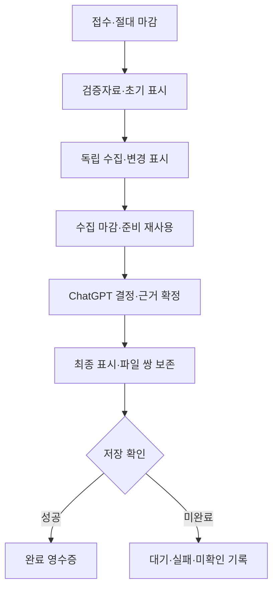

# MON 보강 설계 D1.4

2026-10-11 KST · mon.php1.7.0 · monitor.md v4.7 · MON-STATS-1.0 / MON-ADAPTIVE-1.0

접수·첫 제어·실측 단계·실제 시도/작업 수·오류·복구·표시 보고·미완료를 기록한다. 보호 실행 저널과 원자 통계 저장을 분리해 종료/저장 실패에도 영수증과 미완료를 잃지 않는다. 통계는 workload별 최근30일·최대60회/256KiB이며 정확한 값, 운영자 보고, 미측정, 중단 하한을 구분한다. 동일 run ID는 upsert/revision으로만 갱신하고 입력 해시·스키마·중복/충돌을 검증한다. 키/가격/HTTP 본문은 저장하지 않는다.

제어기는 다음 시작에만 실행한다. 기본120초, 실측 p90×1.25·마감 초과 하한·호출 수 p90·재시도 성공률을 쓰고 전체300초/HTTP60회/상세3회 상한을 유지한다. 현재 정책과 통계 SHA/세대/workload는 immutable_sha256에 포함한다. 같은 ID의 재개/새 이력으로 마감을 연장하지 않는다. 명시 normal/extended와 기존 정책 없는 실행/요청은 호환한다. 보관 통계에 이미 끝난 ID가 있는데 보호 문맥이 없으면 재시작으로 deadline을 새로 만들지 않는다.

중단 복구는 새 실행 시작에서 보호 인덱스의 최대8건을 확인한다. 원래 복구 마감 뒤 종료 확인이 없으면 censored/expired로 기록하며 실제 처리 종료라고 추정하지 않는다. 미완료 ID/오류를 다음 처리 참고로 제공하되 현재 원문 SHA·목표 완료일·가격 기준을 다시 검증해 새 요청을 만들고 완료 원문/지수를 재사용한다. 기간 부족·가격 충돌 등 영구 입력 오류는 재시도 증가 대상이 아니다. 최종 자율 판단·원자 파일 쌍·실제 ref 확인은 기존 검증을 사용한다.

NAS 통계는 보호 파일, 불가 시 고정 PHP 함수의 검증 snapshot과 기존 Git 커넥터/CAS 병합을 사용한다. 통계 저장은 analysis/result와 분리한다. 이미 끝난 실행의 게시가 뒤늦게 확인되면 실제 HTTP/게시 시간·시도와 동일 통계 행을 갱신한다. 서버 완료와 채팅 표시 시각은 분리한다. 증가한 전체 한도는 NAS 회차/메모리/CPU/자동 시작 한도를 바꾸지 않는다.

시뮬레이션에서 rolling merge의 array_slice 인자 오류를 수정했다. 확인된183초 하한의 다음 한도230초, 5회 안정 완료 뒤240→230초, 유익/무익 재시도3/1회, 연속12회 현재 한도 고정/다음 한도 전환, 중단/통계 잠금/실제 로컬 인증/모의 게시 저장을 확인했다. 새 검증55 PASS/0 FAIL; 실제 NAS/공급자 성공과 실제 채팅 전달 시간은 검증하지 않았다.

## D1.3의 수동 시작·부하 설계 유지

2026-10-11 KST · mon.php1.6.2·monitor.md v4.6 · NAS 부팅 수동 시작과 데몬 부하 제어

옵션 없는 CLI의 daemon 시작과 무권한 --run을 제거한다. 웹 POST 시작 때 현재 Linux boot_id(없으면 /proc/stat btime)·인스턴스에 묶인15초 일회용 난수 권한을 보호 파일에 해시로 저장한다. CLI 작업자는 기존 daemon.lock 뒤 start_gate.lock에서 한 번 소비한다. 이전 부팅/만료/재사용은 거절하며 부팅 정보가 없으면 보류한다. 웹 GET/설정/게시 등록은 권한을 만들지 않는다. Stop은 발급/활성 권한을 폐기하고 인스턴스 중지를 기록해 실행 전/heartbeat 전 경합도 막는다. 자동 재시작 관리자·cron은 만들지 않는다.

| 부하 원인 | 설계 변경 | 경계 |
|---|---|---|
| 10초마다 큰 원문 내려받기·캐시 쓰기 | 대기 조회 최소30초·서버 ETag 조건부304·같은 blob SHA 캐시 쓰기 생략 | ETag가 없으면 정상 다운로드, 변경 원문/SHA 확인·충돌 재병합 유지 |
| 회차3개 상세·전체55초 연속 작업 | 데몬만 상세1개/8초·전체25초·시세2개/6초·종목3초 | 전체 목록 유지·커서 순환, 느린 시세도 다음으로, 직접 함수의 기존 한도 유지 |
| 할 일이 없어도 압축 원문 준비 | 요청 없음·완료·미도래 재시도면 상세 원문 해제 생략 | 재시도 도래/원래 마감에는 기존 처리, 새 판단 생성 안 함 |
| 다른 NAS 작업과 경쟁 | nice +10·PHP 최대96MiB·실제 CPU 시간×9/최소5초 유휴 | 더 작은 기존 PHP 한도 유지·적용 실패/측정 불가 공개, 10%는 목표 |
| 과부하에서 계속 조회 | CPU 수당 load>1.25 또는 여유 RAM<max(32MiB, 전체10%)에30/60/120초 대기 | 회복 여유 기준2회 연속·resource_paused, 마감 연장 없음 |
| 5초마다 heartbeat·설정 파일 해시, 브라우저3초 조회 | 대기20초·브라우저10초/숨긴 탭 중지 | 상태 변경/종료 즉시 기록, 짧은 중지 확인 유지 |
| 과부하 때 큰 게시 artifact 처리 | 네트워크 예산0이면 작은 저널 만료만 확인·원문 해제 안 함 | 원래 만료/unknown 유지; 예산 있는 정상 경로의 artifact 검증 유지 |

메모리 측정은 MemAvailable을 우선하고 구형 커널에는 MemFree+Buffers+Cached+SReclaimable−Shmem 근사치를 사용한다. CPU 회복은 load≤CPU 수×0.9, RAM은 정지 기준×1.25 이상을2회 확인한다. 과부하가 오래 지속하면 요청이 만료하거나 가격이 오래될 수 있다. 확보한 과거 자료로 부족/조건부를 표시하고 현재 ready·저장 완료로 올리지 않는다. 자료 날짜·선정 규격·보유 정보·판단 파일은 바꾸지 않는다.

검증 중 초기 모의의 웹 상태에는 instance_id가 누락됐고 게시 fixture가 잘못된 스키마/함수명을 사용했다. 운영 계약에 맞는 합성 fixture로 수정했다. 게시 예산0 경로와 정상 경로를 분리해 정상 artifact 무결성 검증을 보존하는 경계도 추가했다. 최종 새 경로 실제 PHP7.4.33 함수·한 회차 실행 모의41＋로컬 HTTP/CLI16=57 PASS/0 FAIL. 실제 두 프로세스의 권한 중복 소비 차단도 포함한다. 원천/시스템 측정값은 모의이고 실물 NAS 재부팅·부하 절대치·배포는 확인하지 않았다. [구현·검증 보고](mon_reinforcement_implementation.md)를 따른다.

## D1.2 설계·구현 이력

2026-10-11 KST · mon.php1.6.1·monitor.md v4.5 · 기존 D1.1의 세 장애 복구 보강

직전259.2초 실행은 시작/지시문 확인에서 이미 마감을 넘겼다. 첫 결과 확보 전 큰 자료·문맥 처리를 요구하는 흐름, 첫 KIS가 대체/지수 시간을 소진하는 흐름, 종목 성공 후 지수 실패의 원문 폐기를 수정한다. 원래 마감을 늦춰 성공처럼 표시하지 않는다.

| 설계 | 반영·검증 |
|---|---|
| 빠른 기존 결과와 새 검증의 분리 | MonBootstrap·start.initial_result, 원문 해제/지표 준비0의 초기 결과·작은 고정 페이지 |
| 8초 안에서 대체 원천/지수 기회 예약 | 지수35%(최대3초), 첫 KIS는 해당 잔여45%; 공통 MonHttp 원래 마감 유지 |
| 공통 공급자 장애의 제한된 차단 | 기존 인스턴스에서30초/429 Retry-After; 단일 시간 초과/5xx는 주소별, 서로 다른 주소2건 때 공통 차단; 개별404·다른 원천·Git 확인 분리 |
| 지수부터 재개하는 성공 원문 보존 | 같은 request_hash/종목/완료일/source hash/원래 기한, 손상·새 요청·만료 거절 |
| 날짜가 맞는 지수 재활용 | 정확한 지수·같은21일이면 과거 종목과 묶인 저장 지수도 사용, origin 시각 보존 |
| 재시도 원인/기한 구분 | 접속·429/5xx만 최대2회, 불변 매핑/날짜/기준 오류는 부족 필드·이전자료로 종료 |
| 호출 경로 전체의 마감·완료 구분 | 직접 prepare/finalize에도 마감 검사; 서버 확정 여부·과거 재표시·저장 상태 분리 |

새 경로 PHP7.4.33 함수31＋로컬 HTTP17=48 PASS/0 FAIL. 외부 원천·주문·새 데몬0. 실제 NAS 배포/원천 성공/미국 누락 해소/ChatGPT120초 완료는 별도다. [구현·검증 보고](mon_reinforcement_implementation.md)를 따른다. 기존 수치 기준·후보 동등 경쟁·파일 쌍·웹 시작/중지·기존 데이터는 유지한다.

## D1.1 설계·구현 이력

2026-10-11 KST · 코드·지시문·wiki 구현 및 변경 검증 완료 · NAS 적용 전

**종목별 실패, 자료 자격, 현재 진입 가능 여부, 저장 상태를 분리한다.** 제한시간 안에 확보한 자료로 결과를 표시하고, 실패한 한 종목이나 저장 요청이 다른 결과를 막지 않게 한다.

설계 출발점은 wskimgit/stock의 mon.php1.5.0·monitor.md v4.3이며 구현 결과는 **mon.php1.6.0·monitor.md v4.4·MON-RUN-1.1**이다. RS·MA5·MACD(12,26,9)·MON-P3.1·MON-SWING-1.1·기존 종목별 처리·이전자료 활용을 유지했다. P0~P3의 코드·지시문·wiki를 반영하고 실제 PHP7.4 변경 검증을 수행했다. 실제 추천자료·NAS 배포·재시작·주문은 변경하지 않았다. [구현 및 검증 보고](mon_reinforcement_implementation.md)에 상세 근거가 있다.

## 1. 근거

기준 커밋: [7d0307e](https://github.com/wskimgit/stock/commit/7d0307e7630db21b811d6bfb5f76daa799bcf31c). mon.php blob은76f19d970a65c6e7ac6f09d2bf4ea79061409005다.

| 확인한 사실 | 보강 대상 |
|---|---|
| 직전 실행 측정349.433초·첫 결과33.542초; 첫 기록 이전 준비시간 미측정 | 접수부터 계측, 실제 마감 제어 |
| 자료 확인167.315초·판단120.358초·저장61.760초 | 중복 왕복 제거·파일 전달과 저장 축소 |
| 대용량 최종 JSON의 파싱 실패 | 큰 본문을 모델 출력에서 분리 |
| 토큰 불일치 후 정규화로 복구 | 발급·검증의 표준 입력 통일 |
| NAS Proxy CONNECT 시간 초과 | 접근 실패와 실제 NAS 정지 구분 |
| 신규 일봉 성공0·신규 후보 추가0·미국 최신 비교 미완료 | 누락 자료·신규 탐색을 초반부터 배정 |
| MonRun::token은 전달된 문맥 그대로 해시 | 문맥·시각·정렬·중복 제거 통일 |
| MonDetails::select와 MonSwing::select의 중복 prepare 호출 경로 | 서버 내부 준비 bundle 재사용 |
| MonDaily::fetch의 공통 일봉 전체 digest 비교 | 충돌 필드·원문 계보 진단 추가 |

## 2. 시뮬레이션에 따른 수정 이력

| 단계 | 검증 결과 | 설계 변경 |
|---|---|---|
| 초기 문장 설계 D0.1 / 모델 A | 확대66사례 중18조건 충족 | 절대 마감·정규화·캐시·페이징·게시 경계 구체화 |
| 최초 보강 B0 | 1차50사례 모두 조건 충족 | 원래 마감, UTC 정규화, 수치 캐시와 상태 구분 |
| B0 추가 경계 검토 | 확대66사례 중51조건 충족·15개 공백 | 과거자료 자격, 가격 구간, 위험 유효기간, 초대형 카드, 영속 저장 보강 |
| 최종 보강 B / D1.0 | 66/66 조건 충족 | 아래 최종 설계 |
| 가상 지연2,500회 | 조건 위반0; 제한 내 저장720·미완료1,780 | 최종 표시와 전체 저장 완료를 구분 |
| 가상 게시 복구1,000회 | 조건 위반0; 저장425·만료174·판단 충돌201·미확인200 | 실패·미확인 상태와 원문 파일을 보존 |
| 실제 PHP7.4 토큰 재현 | 원문 토큰 불일치·정규화 일치·소스 변경 감지 | 정규화 경계 확인 |
| D1.1 실제 코드 보강 | PHP7.4 함수·게시 모의75/75, 로컬 HTTP·DOM 모의30/30 | 재개 시 시계 후퇴, 응답 사실 대조, 일별 신원 집계, 중첩 artifact·실제 표시 재검증 추가 |

A와 B0는 초기 설계의 구현 가정을 재현한 모형이다. 현 운영 코드의 오류율이나 성능을 뜻하지 않는다. **가상 시간의 PASS는 실제 ChatGPT/NAS가120초 안에 끝나거나 모든 저장이 성공한다는 증거가 아니다.**

## 3. 시간과 마감

시작에 received_at·first_control_at·mode·원래 마감을 고정한다. 접수부터 전체 시간을 기록한다. 각 프로세스의 경과는 단조 증가 시계로 측정하고 UTC는 자료 날짜·교차 프로세스 마감에 사용한다. 첫 제어 이전 구간을 측정할 수 없으면 partial_timing=true다.

| 구간 | 일반 모드 목표 | 마감 행동 |
|---|---|---|
| 초기 표시 | 10~20초 | 확보자료·기준일·부족자료·확인 대상 표시 |
| 수집·독립 확인 | 원래 시작+100초 | 새 수집 중단, 성공한 종목 보존 |
| 판단·검증·최종 표시 | 원래 시작+110초 | 확보자료와 ChatGPT의 명시적인 결정으로 확정 |
| 게시 시도·상태 확인 | 원래 시작+120초 | saved/failed/queued/unknown 구분 |
| 추가 준비·예외 게시 | 원래 시작+300초 이내 | 이유·추가 상태 기록; 시작시각 재설정 금지 |

호출 timeout=min(기존 호출 한도, 단계 마감−현재시각)이다. 여유가 없으면 호출하지 않는다. 한 종목의 KIS→대체 원천→지수 요청도 같은 절대 마감을 공유한다. 재시도는 최대2회·30초 대기·전체 마감 중 먼저 오는 조건을 따른다.

취소 가능한 PHP/실행기 호출은 마감에 취소한다. 취소 불가 외부 도구·ChatGPT 생성 대기는 임의로 중단하거나 최종 채팅 표시를 강제할 수 없다. 이 경우 deadline_missed를 기록하고 제어가 돌아온 즉시 새 작업을 중단한다. 서버의 마감 기능만으로 ChatGPT 전체 대기시간을 보장하지 않는다.

마감 시 새 자율 결정이 없으면 검증된 이전 판단을 원래 시각으로 표시하거나 자료 상태를 출력한다. 모든 자료 실패는 자료 부족, 모든 자격 실패는 매입 없음이 가능하다. PHP가 새 종목을 자동 선정하는 대체 경로를 만들지 않는다.

## 4. 작은 응답과 파일 매니페스트

전체 JSON·Base64·원문 일봉은 파일과 기존 저장 데이터에 보존한다. 모델에는 카드·변경·정확한 source SHA만 전달한다.

| 응답 | 제안 규격 |
|---|---|
| 진행 | 4KiB 목표; 변경 토큰·종목별 상태·검증 전 생산자 메타정보 |
| 준비 카드 | 기존12KiB=12,288바이트 상한; UTF-8 바이트로 측정 |
| 최종 매니페스트 | 파일명·크기·SHA256·Git blob SHA·source SHA·준비 fingerprint |
| 단일 초대형 카드 | 작은 참조 카드와 hash 검증 원문 artifact; 묵시적 절단 금지 |
| 저장 영수증 | job_id·상태·실제 ref·완료시각·오류·실제 경과 |

참고 카드와 헤더도 페이지 상한에 포함하고 모든 페이지/참조는 같은 fingerprint로 고정한다. 파일 생성 후 전송할 실제 바이트를 다시 해시로 확인한다. 파일명은 고정 결과명과 서버가 생성한 ID만 허용한다.

파일 업로드 어댑터 또는 정상 NAS의 게시 경로를 사용한다. 문자열 본문만 받는 커넥터에서는 고정 크기 청크를 한 오케스트레이션에서 자동 연결하고 해시를 확인한다. 경로 업로드 기능이 없는 환경에서 경로만으로 Git 저장이 가능하다고 가정하지 않는다.

## 5. 정규화·캐시·최종 확정

토큰은 고정 문맥 필드·기본값·UTC6자리 시각·국가 정렬·중요 ID 중복 제거/정렬을 한 함수로 처리한다. 발급과 검증이 같은 문맥을 사용한다. source SHA·규칙·소유권 검사는 유지한다. 실제 소스 변경을 무시하기 위해 토큰을 재발급하지 않는다. 새 형식은 버전을 명시하고 기존 인터페이스는 호환 경로를 유지한다.

수치 캐시 키는 종목 전체 이력·지수 전체 이력·동일21일 비교 기간·가격 조정·규칙 버전·신원/통화/공급자 매핑·호가 규칙·검증 캘린더·목표 완료일·독립 장중 관측을 포함한다. 일반 시세 collection ID나 표시시각만 바뀌면 수치 전체를 다시 계산하지 않는다.

**매입 가능 상태는 수치 캐시와 함께 재사용하지 않는다.** 최종 표시에서 원래 가격시각·허용 지연·정규장·진입 구간·거래 가능 확인·기업 검증일과 미확인 항목을 다시 검사한다. 확인된 중대한 악재는 신규 진입을 차단한다. 보유분의 매도는 기존 별도 규칙을 유지한다. 시장 종가를 지나 목표 완료일이 바뀌면 같은 원문이어도 기간·자격을 갱신한다.

### 구현 mon_detail_finalize 인터페이스

mon.php1.6.0에 구현했다. 입력은 문맥의 run_context_id, 고정 source SHA/token, prepared fingerprint, ChatGPT의 selected/references·이유, confirmations의 독립 근거/가격/위험 관측, response_mode·publish_mode와 expected head다. [monitor.md 6.6](monitor.md#66-보강-실행통합-확정게시-계약)의 정확한 요청·인증·호환 규격을 따른다.

소스·시간·소유권 검증→서버 내부 준비 bundle 확인→선정 자격 검증→결정과 근거 동시 반영→최종 두 파일 한 번 생성·검증→작은 매니페스트/게시 작업을 반환한다. 클라이언트가 보낸 full_signals나 자격 true는 신뢰하지 않는다. 내부의 동일 준비 결과를 재사용해 중복 prepare를 없애며 실제 수치 입력이나 기간이 바뀌면 갱신한다.

## 6. 자료 상태와 가격 충돌

| 자료 상태 | 해석 |
|---|---|
| 최신 완료봉 동일 기간·기준 검증 | 현재 완료봉 자격 평가; 현재 진입 확인은 별도 |
| 최신 완료봉 캐시 재사용 | 원래 checked_at 보존; 휴일만으로 과거자료 강등 금지 |
| 최신 종목 가격만 성공 | 가격 참고; 이전 RS/MACD와 합성 금지 |
| 최신 완료봉/지수 누락·원문 충돌 | 과거 강도와 기술신호를 검증했을 때만 참고 선정 |
| 이전자료도 손상·자격 미검증 | 자료 부족; 참고 종목으로 채우지 않음 |
| 요청·신원·기간·hash 불일치 | 응답 격리; 원래 검증자료 별도 보존 |

충돌 진단에는 종목·공통 날짜·충돌 필드·양쪽 원문 값·가격 기준·공급자·원문 hash·검증시각을 넣는다. OHLC·거래량·조정 정보를 비교한다.

139.40과139.39500427246094 같은 값도 자동 허용하지 않는다. 동일 원문 record 계보와 표시 정밀도가 확인되고 표시값이 원문에서 정확히 파생된 경우만 display_only다. 계산에는 검증 원문을 사용한다. 다른 원문·조정 기준·설명되지 않은 차이는 계속 충돌이다. 단순 허용 오차 확대나 일괄 호가 반올림으로 해결하지 않는다.

종목명은 검증 symbol_id 매핑을 사용한다. 매핑이 없으면 코드와 이름 미확인을 표시하며 다른 회사명을 추정하지 않는다.

## 7. 누락 자료·신규 탐색·표시

초반에 현재 목록·최근20거래일 후보·새 근거가 있는 과거 후보·신규 후보를 함께 구성한다. NAS 건강 조회는 짧게 한 번 하고, 누락 완료봉/지수 보완과 신규 탐색을 독립 요청으로 배정한다. 같은 실패 경로를 새 근거 없이 반복하지 않는다.

활성30개·국가별 상세 관찰10개는 요청 관리 한도이며 전체 후보 평가의 한도가 아니다. 신규20개/국가/거래일 목표는 해당 시장 거래일 누적값으로 관리한다. 서버가 고정한 최초 발견일과 독립 신원 근거의 이름·국가·거래소·통화·종목 매핑을 확인한다. 오래된 new_in_mon 표시를 다시 신규로 세지 않는다. 발견한 신원 확인 후보, 상세자료 확보, 수치 자격 검증을 고유 ID로 별도 집계한다. 중복이나 신원 미확인으로 목표를 채우지 않는다. 국가별·신규/이전별로 탐색 기회를 배정하며 속도·신규성에 선정 가산점을 주지 않는다.

초기→유의미한 변경→최종을 기본으로 한다. 같은 진행 토큰은 반복 읽지 않는다. 변화가 없으면2회다. 모든 카드와 참고 카드를 같은 기준으로 검토한다. 최종 표는 판단시각·가격시각·봉 날짜·원문 확인시각을 구분한다. usable_reported·collection_complete·파일 hash 일치를 현재 매입 가능으로 해석하지 않는다.

장애는 단계·종목·코드·시각·횟수·복구·이전자료·결과 영향·다음 확인 대상을 기록한다. NAS 접근 실패는 access_unconfirmed이며 NAS 정지는 별도 확인이 있어야 한다.

## 8. 원자적 저장과 정확한 완료 상태

새 데몬/cron 없이 기존 mon.php에 영속 게시 작업 단계를 구현했다. 검증된 두 파일을 같은 폴더의 보호 PHP 상태에 먼저 보관하고 두 SHA·base head·고정 decision hash로 job_id를 만든다. 영속 저장 성공 후에만 queued 접수를 반환한다. 같은 요청은 같은 작업을 재사용한다. 재시작 후 파일 SHA·journal·job_id와 원래 마감을 확인한다. 시계 후퇴와 손상된 작업은 격리한다.

웹 Git 쓰기는 기존 운영자 인증/권한과 연결한다. 자격증명은 응답/로그에 노출하지 않고 임의 경로·저장소·브랜치 쓰기를 허용하지 않는다. NAS 불가 시 커넥터와 검증 파일로 저장을 시도한다. 영속 작업을 확보하지 못한 경우 저장 재개를 보장한다고 쓰지 않는다.

게시 상태는 queued→publishing→saved/conflict/failed/expired/unknown이다. 원래 시작+300초 이후 미완료 작업은 만료 또는 미확인으로 남기고 일반120초 완료로 세지 않는다. 새 시세나 새 판단시각을 자동 생성하지 않는다.

두 blob→같은 tree→한 commit→expected head를 확인한 ref 갱신 순서다. blob 하나 생성 후 중단해도 공개 파일 쌍은 기존 상태다. 커밋 객체 생성만으로 저장 성공을 표시하지 않는다. 응답 유실은 예상 ref/commit와 파일 hash를 한 번 확인하고 불가하면 unknown이다. 무조건 재커밋·force push하지 않는다.

최신 collection만 바뀌면 소유권 범위에서 한 번 병합하고 판단시각을 보존한다. 새 상세 수치 자료가 마감 뒤 추가되면 pending_analysis=true로 표시해 현재 판단에 반영되지 않았음을 밝힌다. 다른 판단/설정 변경은 덮어쓰지 않는다. 재병합 최대1회다.

수치 입력·선정·근거·위험·계획이 모두 같으면 재커밋하지 않는다. 표시시각·접근시각·왕복 수만으로 새 판단을 만들지 않는다. 수치는 같아도 새로운 기업 근거가 있으면 저장할 수 있다.

저장 전 최종 파일에는 pending과 당시 측정 구간만 기록한다. 실제 완료시각·commit SHA·저장시간은 저장 후 기존 데몬 상태/작은 영수증과 최종 채팅에 기록한다. 자기 커밋 SHA를 같은 커밋에 넣기 위해 두 번째 커밋을 만들지 않는다. final_available와 save_status를 독립 표시하고 queued/unknown을 전체 저장 완료로 쓰지 않는다.

## 9. 처리 흐름

## 10. 구현 대응과 실환경 합격 조건

| 순서 | 구현한 코드·지시문 | 남은 실환경 확인 |
|---|---|---|
| P0 | MonBudget/Execution·정규화 token·MonPaging/Artifact·보호 인증·초기/중간/최종 표시 지시 | NAS 인증·파일 보존, 접수 이전 구간과 취소 불가 대기 포함 실제 계측 |
| P1 | MonPreparation·MonDetails.finalize·MonConfirmation/Meaning·MonBarConflict | 실제 원천 계보/충돌, 시장 종가 전후·독립 가격/위험 확인 |
| P2 | MonPublication·기존 데몬 게시 단계·실제 ref/파일 쌍 영수증·재개/unknown | NAS 권한·실제 Git 병행 쓰기·네트워크 응답 유실·재시작 |
| P3 | MonDiscovery의 국가/신규/이전 교차 배정·최초 발견/신원 집계·누락 보완 지시·실패 결과 표시 | 실제 발견/확보/검증 범위와 신규20개 목표, 탐색의 시장 대표성 |

초기20초·준비자료 판단60초·일반120초는 NAS 적용 뒤 실제 접수부터 저장/실패 확정까지 계측한다. 주말, 장중, NAS 불가, 원천 충돌, Git 동시 변경을 구분한다. 취소 불가 호출은 초과 진단·보존을 검증하며 전체 시간 목표 달성으로 세지 않는다. PHP7.4와 기존 웹 시작·중지를 유지했다. 기존 PASS 전체 재시험·정상 지표 재작성·NAS 배포는 이번 구현에서 수행하지 않았다.

## 11. 산출물과 제한

- [구현·변경 검증 보고](mon_reinforcement_implementation.md)
- [실제 PHP7.4 변경 시험](tests/mon_reinforcement_test.php) / [75사례 원시 결과](tests/mon_reinforcement_implementation_tests.json)
- [실제 로컬 HTTP·DOM 모의 시험](tests/mon_reinforcement_http_test.py) / [30사례 원시 결과](tests/mon_reinforcement_http_tests.json)
- [상세 시뮬레이션 보고](mon_reinforcement_simulation.md)
- [재현 시뮬레이터](tests/mon_reinforcement_simulation.py)
- [최종 원시 결과](tests/mon_reinforcement_simulation.json)
- [1차50사례 기록](tests/mon_reinforcement_simulation_round1.json)
- [현 PHP 토큰 재현](tests/mon_reinforcement_token_probe.php)
- [PHP7.4 재현 결과](tests/mon_reinforcement_token_probe.json)

D1.0 모델은 합성 자료 D00~D20과 가상 사건으로 상태·마감·캐시·hash·게시를 검증했다. D1.1은 실제 수정된 PHP7.4의 계산·파일·저널·모의 Git·로컬 HTTP와 렌더링된 JavaScript를 추가 검증했다. 모두 합성 금융자료이며 실제 API/주문은0이다. 실제 NAS 속도·KIS 성공·운영 인증·Git 병행 쓰기·ChatGPT 대기·탐색의 시장 대표성·선정 정확성은 후속 실환경 검증 대상으로 남는다. 구현·로컬 통과와 NAS 운영 적용은 별개다.
